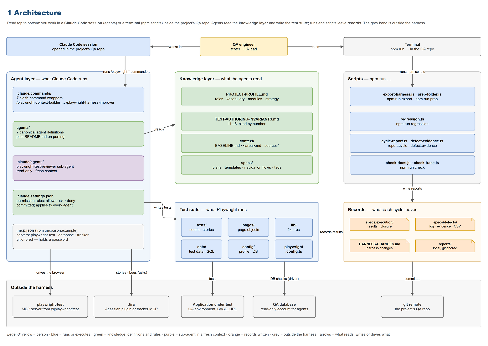
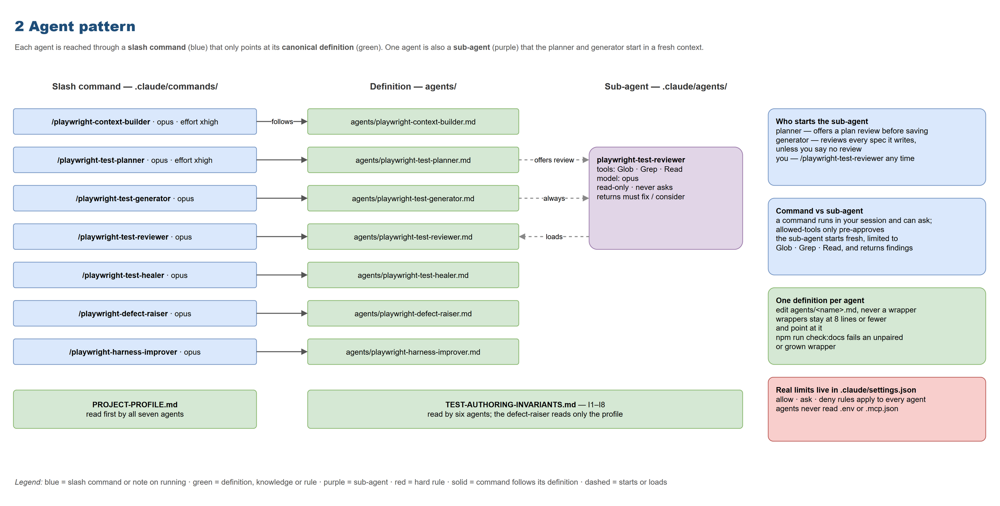
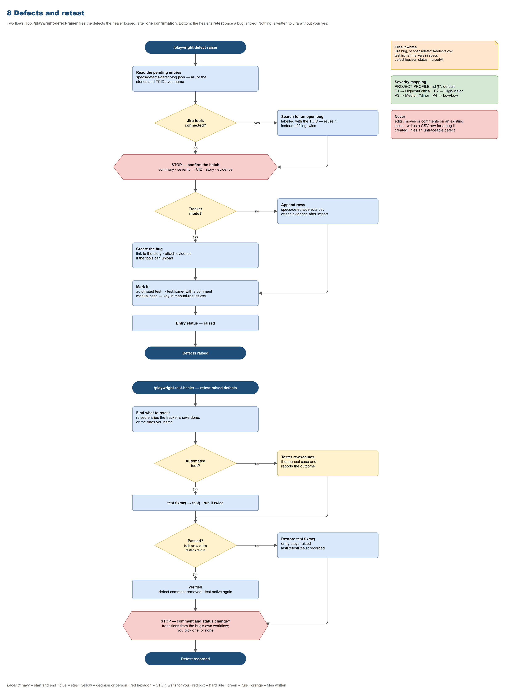
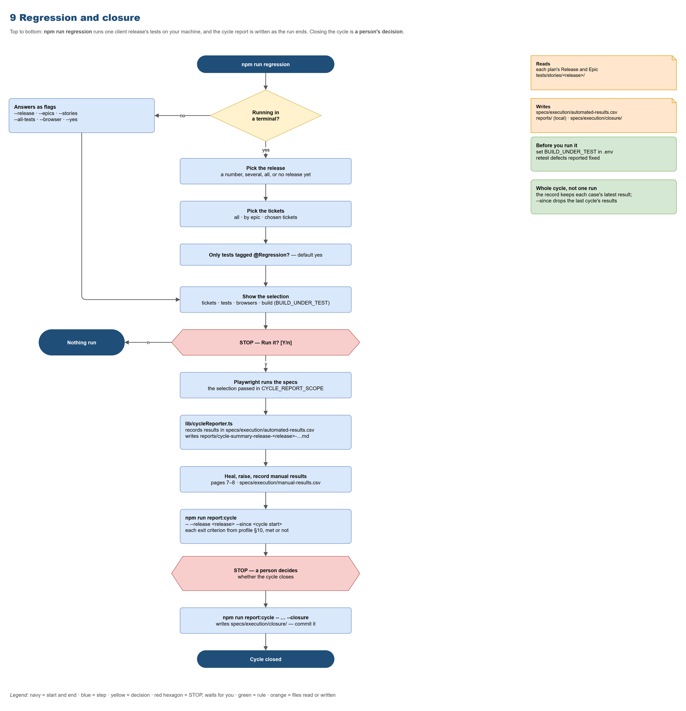
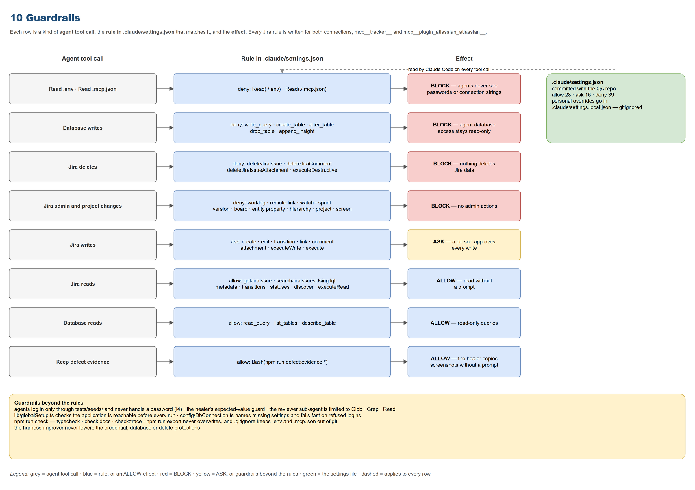
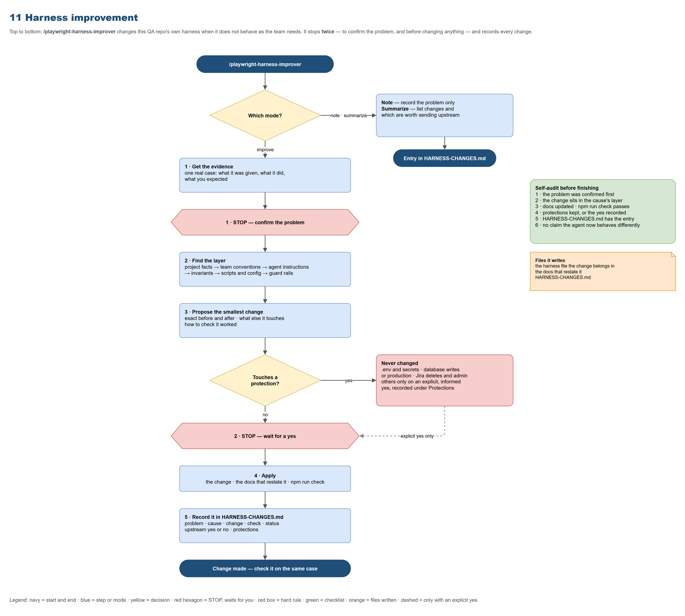

# AI Test Harness — how the agent system works

The AI Test Harness is a QA layer for Claude Code: seven specialist agents, shared project knowledge, a
Playwright + TypeScript test suite, and the npm scripts around it. Six agents learn the application, plan
test cases, generate tests, review them, heal failures and file defects; a seventh adapts the harness itself.
Each agent stops at human approval gates, and permission rules in `.claude/settings.json` limit what any
agent may do. This guide explains how the pieces fit together, with a diagram for each part.

- **Audience:** QA engineers and QA leads who run the agents, and whoever maintains a project's copy of the
  harness.
- **Where it lives:** [agents/README.md](../../agents/README.md) (agent definitions),
  [context/README.md](../../context/README.md) (project knowledge),
  [specs/execution/README.md](../../specs/execution/README.md) (results and closure),
  [specs/defects/README.md](../../specs/defects/README.md) (defect log), and the command reference in
  [docs/AGENTS.md](../AGENTS.md).
- **Diagrams:** the editable source is one multi-page draw.io file,
  [ai-qa-harness.drawio](diagrams/ai-qa-harness/ai-qa-harness.drawio). The PNGs are exported from it (see
  [Updating the diagrams](#updating-the-diagrams)).

## Contents

1. [Architecture — agents, knowledge, test suite](#1-architecture--agents-knowledge-test-suite)
2. [Agent pattern — command, definition, sub-agent](#2-agent-pattern--command-definition-sub-agent)
3. [End-to-end testing lifecycle](#3-end-to-end-testing-lifecycle)
4. [Context-builder setup](#4-context-builder-setup)
5. [Test planning](#5-test-planning)
6. [Test generation](#6-test-generation)
7. [Healing failures](#7-healing-failures)
8. [Defects and retest](#8-defects-and-retest)
9. [Regression and closure](#9-regression-and-closure)
10. [Guardrails](#10-guardrails)
11. [Harness improvement](#11-harness-improvement)
12. [Cross-cutting concepts](#12-cross-cutting-concepts)
13. [Which command do I use?](#13-which-command-do-i-use)
14. [Updating the diagrams](#updating-the-diagrams)

---

## 1. Architecture — agents, knowledge, test suite



You work in a Claude Code session opened in the project's QA repo, or in a terminal in the same repo. The
agents read the knowledge layer and write the test suite. Test runs and scripts leave records.

| Layer | Folder | Holds | Executes? |
|---|---|---|---|
| Agent | `.claude/`, `agents/` | Slash commands, agent definitions, the sub-agent, permission rules | Yes — Claude Code runs the agents |
| Knowledge | `PROJECT-PROFILE.md`, `TEST-AUTHORING-INVARIANTS.md`, `context/`, `specs/` | What the agents know about the application and the rules tests follow | No |
| Test suite | `tests/`, `pages/`, `lib/`, `data/`, `config/`, `playwright.config.ts` | The Playwright suite | Yes — Playwright runs it |
| Scripts | `scripts/` | Export, prep, regression, reports, checks | Yes — `npm run …` |
| Records | `specs/execution/`, `specs/defects/`, `HARNESS-CHANGES.md` | Results, defects, closure reports, harness changes | No |

**Agent layer**

| Path | Purpose |
|---|---|
| [.claude/commands/](../../.claude/commands/) | Seven slash-command wrappers, each pointing at its definition |
| [agents/](../../agents/) | The seven canonical agent definitions |
| [.claude/agents/](../../.claude/agents/) | The `playwright-test-reviewer` sub-agent |
| [.claude/settings.json](../../.claude/settings.json) | Permission rules: allow, ask, deny |
| [.mcp.json.example](../../.mcp.json.example) | MCP servers: `playwright-test`, `database`, `tracker`; copied to `.mcp.json`, which is gitignored |

**Knowledge layer**

| Path | Purpose |
|---|---|
| [PROJECT-PROFILE.md](../../PROJECT-PROFILE.md) | Roles, vocabulary, modules, severity rubric, test strategy, exit criteria |
| [TEST-AUTHORING-INVARIANTS.md](../../TEST-AUTHORING-INVARIANTS.md) | Rules I1–I8 every test follows |
| [context/](../../context/) | `BASELINE.md`, one document per area, and `sources/` for the project's documents |
| [specs/](../../specs/) | Plans, plan templates, navigation flows per role, regression tags |

**Test suite**

| Path | Purpose |
|---|---|
| [tests/](../../tests/) | `seeds/` (one login file per role), `seed.spec.ts` (signed out), `stories/`, `example.spec.ts` |
| [pages/](../../pages/) | Page objects, including `LoginPage.ts`, `DashboardPage.ts` and `common/Logout.ts` |
| [lib/](../../lib/) | `BaseTest.ts` fixtures, `globalSetup.ts` readiness check, `cycleReporter.ts` |
| [data/](../../data/) | `testData.ts`, `auth_data.ts`, `sql_queries.ts`, `seed.ts` |
| [config/](../../config/) | `projectProfile.ts`, `testConfig.ts`, `DbConnection.ts` and its adapters |

**Scripts and records**

| Path | Purpose |
|---|---|
| [scripts/](../../scripts/) | `regression.ts`, `cycle-report.ts`, `defect-evidence.ts`, `check-docs.js`, `check-trace.ts`; in the template only, `export-harness.js` and `prep-folder.js` |
| [specs/execution/](../../specs/execution/) | `automated-results.csv`, `manual-results.csv`, `closure/` |
| [specs/defects/](../../specs/defects/) | `defect-log.json`, `evidence/`, `defects.csv` |
| [HARNESS-CHANGES.md](../../HARNESS-CHANGES.md) | Changes a QA repo makes to its own harness |

**Optional integrations.** The `playwright-test` MCP server is required by the context-builder, generator and
healer. The `database` server (a read-only QA account) is optional: without it, agents ask you for queries and
the healer reports database-backed failures instead of judging them. Jira is optional, through the Atlassian
plugin or the `tracker` MCP entry: without it, you paste stories into the planner, the defect-raiser writes
`specs/defects/defects.csv` for import, and you tell the healer which defects were fixed. See
[docs/MCP.md](../MCP.md).

---

## 2. Agent pattern — command, definition, sub-agent



An agent is reached in one of three ways:

1. **A slash command.** `.claude/commands/<name>.md` holds Claude Code frontmatter (`description`,
   `allowed-tools`, `model`, and `effort` for two agents) and one instruction: read
   `agents/<name>.md` and follow it.
2. **The canonical definition.** `agents/<name>.md` holds all of the agent's instructions, in plain markdown.
3. **A sub-agent.** `.claude/agents/playwright-test-reviewer.md` lets the planner and the generator start the
   reviewer in a fresh context. It also points at `agents/playwright-test-reviewer.md`.

Wrappers defer to the definition. For example, to change how the healer treats a failing assertion, you edit
`agents/playwright-test-healer.md`; the wrapper `.claude/commands/playwright-test-healer.md` stays as it is.
`npm run check:docs` fails if a wrapper or sub-agent file has no matching definition, does not point at it,
or grows beyond 8 lines of content.

Notable sub-agent settings:

- **Model:** every command and the sub-agent use `opus`; the context-builder and planner also set
  `effort: xhigh`.
- **Read-only:** the reviewer sub-agent has `tools: Glob, Grep, Read` and never edits or asks.
- **Who starts it:** the planner offers a plan review before saving; the generator reviews every spec it
  writes unless you say no review; you can run `/playwright-test-reviewer` directly.
- **Shared reading:** all seven agents read `PROJECT-PROFILE.md` first; six read
  `TEST-AUTHORING-INVARIANTS.md` (the defect-raiser does not).

---

## 3. End-to-end testing lifecycle


```text
npm run prep -- <dir> --name "<project>"     → setup/ · context/sources/
npm run export -- <dir>                      → the harness files in the QA repo
/playwright-context-builder                  → context/BASELINE.md · context/<area>.md · PROJECT-PROFILE.md §2–4
/playwright-test-planner <ISSUE-KEY>         → specs/<ISSUE-KEY>.plan.md · .plan.csv · manual-results.csv rows
/playwright-test-generator <plan>            → tests/stories/<release>/<ISSUE-KEY>.spec.ts · pages/ · lib/BaseTest.ts
npx playwright test <spec>                   → specs/execution/automated-results.csv · reports/
/playwright-test-healer <ISSUE-KEY>          → fixed tests · specs/defects/defect-log.json · evidence/
/playwright-defect-raiser                    → Jira bug or specs/defects/defects.csv · test.fixme(
npm run regression                           → automated-results.csv · reports/cycle-summary-release-<release>-…
npm run report:cycle -- --closure            → specs/execution/closure/
```

Key points:

- **Setup happens once.** Prep, export and the context-builder run when a project starts. The context-builder
  runs again only when the application changes.
- **Plan to raise repeats per ticket.** Every story needs its issue key; test case IDs start with it.
- **Each stage reads files, not conversation.** A plan approved one day generates fine the next.
- **Every run is recorded.** `lib/cycleReporter.ts` writes each test case's latest result and a cycle report as
  the run ends.

Other ways in: `/playwright-test-healer` to retest raised defects, `/playwright-test-reviewer` on any plan or
spec, `/playwright-harness-improver` when the harness does not fit, and `npm run export -- <dir> --example <name>`
for a practice repo.

---

## 4. Context-builder setup


`/playwright-context-builder` establishes what the harness knows about the application. Things to know when
you run it:

| Step | What happens |
|---|---|
| 0 · Preflight | Confirms or sets up the roles, runs every login file, offers to fill the login, signed-in and sign-out selectors, and fetches one Jira story to prove the connection |
| 1 · Inventory | Asks by name which sources exist and can be reached |
| 2 · Roam | Signed out first (`tests/seed.spec.ts`), then each role (`tests/seeds/<role>.spec.ts`), read-only |
| 3 · Read | Specs and rules → Invariants with sources; test cases → Existing coverage; defects → Caveats; Jira live or from a CSV export |
| 4 · Introspect | Only with a reachable database and the MCP server; read-only |
| 5–8 · Write | `context/BASELINE.md`, profile §2–4 and module tags, navigation plans and the cross-role matrix, deep context per named area |

- **STOP gates:** review the preflight · correct the inventory · review the module map · approve the baseline ·
  show each profile draft · show the navigation drafts · show each context document. A failed login stops it to
  ask whether to carry on with the other roles.
- **It never handles a password.** It starts from each role's login file, which logs in inside the test
  runner; agents cannot read `.env`.
- **Re-runs are scoped.** Name an area, module or role to update only that part.

---

## 5. Test planning


`/playwright-test-planner <ISSUE-KEY>` turns one story into `specs/<ISSUE-KEY>.plan.md` and its CSV. Things to know
when you run it:

- **The issue key is required.** Without one, it stops and asks; there is no key-less mode (I8).
- **No browser.** It grounds the plan in the repo: `context/`, the navigation plans, `pages/`, `data/`,
  existing specs.
- **Seven checkpoints:** story and gaps · conventions · reuse and scope · scenario titles · anything new ·
  the full plan · the CSV rows.
- **Optional review.** Before saving, it offers `playwright-test-reviewer` in plan-review mode and folds the
  `must fix` findings in.
- **It owns the test case IDs.** `<ISSUE-KEY>-TC<NNN>`, never renumbered; a dropped scenario is marked
  `Retired`.
- **Manual cases are tracked.** Each manual scenario gets a `Not Run` row in
  `specs/execution/manual-results.csv`.

---

## 6. Test generation


`/playwright-test-generator <plan>` turns an approved plan into a spec. Things to know when you run it:

- **It drives first.** `generator_setup_page` starts from the role's login file, every step runs live through
  the browser tools, and `generator_read_log` must show an action for each step before anything is written.
- **STOP gates:** a missing plan or test case ID · a new page object or method · SQL it does not have · the
  target file path.
- **File path.** `tests/stories/<release>/<ISSUE-KEY>.spec.ts`; with no release yet, the epic's folder or
  `tests/stories/`.
- **Review by default.** After writing, it starts `playwright-test-reviewer` in test-review mode, fixes every
  `must fix` (re-driving the step if needed), and re-reviews once.
- **Tags follow priority.** P1 and P2 get `@Regression` and `@Priority1`/`@Priority2`; P3 gets `@Priority3`;
  each test also gets a module tag from `specs/RegressionTags/regression-tags.md`.

---

## 7. Healing failures


`/playwright-test-healer` fixes failing tests and confirms genuine defects with you. Things to know when you
run it:

- **Name what to heal:** an issue key, a spec, a test case ID, or "what failed in the last run". If you name
  nothing, it lists the last run's failures from `test-results/results.json` and asks.
- **Test-side fixes are automatic:** selectors, waits and locator scope, in the page object or `testData.ts`,
  up to three attempts per test.
- **STOP gates:** what to heal · the expected-value guard (a fix that changes what a test expects needs the
  plan's backing or your yes) · after three attempts · confirming a defect and its severity.
- **Evidence is kept.** After you confirm a defect, it logs it as `pending` and runs `npm run defect:evidence`,
  which copies the screenshots into `specs/defects/evidence/`.
- **Results are recorded.** It runs the healed specs once more with `npx playwright test`.

---

## 8. Defects and retest



`/playwright-defect-raiser` files the defects the healer logged. Things to know when you run it:

- **One confirmation.** It shows the batch — summary, severity, test case ID, story, evidence — and files only
  what you agree to.
- **Two modes.** With Jira tools, it searches for an open bug labelled with the test case ID, then creates the
  bug, links it to the story and attaches the evidence if the tools can upload. Without them, it appends rows to
  `specs/defects/defects.csv`.
- **Marking.** An automated test becomes `test.fixme(` with a defect comment; a manual case gets the key in
  `manual-results.csv`. The log entry moves to `raised`.

The retest is the healer again: it finds raised entries the tracker shows as done, or the ones you name, turns
`test.fixme(` back into `test(` and runs it twice. Passed both times → `verified`; otherwise the `fixme` is
restored. A manual case is re-executed by the tester. Before writing to Jira it stops: you choose a comment and
a transition from the bug's own workflow, or none.

---

## 9. Regression and closure



`npm run regression` runs one client release's tests on your machine. Things to know when you run it:

- **In a terminal it asks:** which release (a number, several, `all`, or no release yet), which tickets (all, by
  epic, chosen), and whether to run only `@Regression` tests. An agent passes the answers as flags:
  `--release`, `--epics`, `--stories`, `--all-tests`, `--browser`, `--yes`.
- **STOP gates:** `Run it? [Y/n]` before anything runs; at the end, a person decides whether the cycle closes.
- **Browsers.** It runs every browser project in `playwright.config.ts` unless you pass `--browser`.
- **The report is automatic.** `lib/cycleReporter.ts` records each result in
  `specs/execution/automated-results.csv` and writes `reports/cycle-summary-release-<release>-….md`.
- **Whole cycle.** `npm run report:cycle -- --release <release> --since <date>` reports the latest result of
  every case since the cycle began, against the exit criteria in profile §10. `--closure` writes the final
  report to `specs/execution/closure/`.
- **Before you run it:** set `BUILD_UNDER_TEST` in `.env`, and retest defects reported fixed.

---

## 10. Guardrails



The harness has no hook scripts. Its guardrails are permission rules in
[.claude/settings.json](../../.claude/settings.json), which Claude Code applies to every agent tool call: 28
`allow`, 16 `ask` and 39 `deny` rules. Every Jira rule is written for both connection prefixes,
`mcp__tracker__` and `mcp__plugin_atlassian_atlassian__`.

| Rule | Behaviour |
|---|---|
| `Read(./.env)`, `Read(./.mcp.json)` | **Blocks** — agents never see passwords or connection strings |
| Database write tools | **Blocks** `write_query`, `create_table`, `alter_table`, `drop_table`, `append_insight` |
| Jira deletes | **Blocks** issue, comment and attachment deletes, and `executeDestructive` |
| Jira admin and project tools | **Blocks** worklog, remote link, watch, sprint, version, board, entity property, hierarchy, project and screen changes |
| Jira writes | **Asks** before create, edit, transition, link, comment, attachment, `executeWrite`, `execute` |
| Jira reads, database reads | Allowed without a prompt |
| `Bash(npm run defect:evidence:*)` | Allowed, so the healer keeps screenshots without a prompt |

To change a guardrail, edit `.claude/settings.json`; personal overrides go in `.claude/settings.local.json`,
which is gitignored.

Safeguards beyond the rules:

- Agents log in only through `tests/seeds/` and never handle a password (I4).
- The healer's expected-value guard; the reviewer sub-agent limited to `Glob`, `Grep`, `Read`.
- `lib/globalSetup.ts` checks the application is reachable before every run.
- `config/DbConnection.ts` names missing settings before connecting and stops on refused logins.
- `npm run check` runs the typecheck, `check:docs` and `check:trace`.
- `npm run export` never overwrites; `.gitignore` keeps `.env` and `.mcp.json` out of git.
- The harness-improver never lowers the credential, database or delete protections.

---

## 11. Harness improvement



`/playwright-harness-improver` changes a QA repo's own harness when it does not behave as the team needs.

1. **Get the evidence** — one real case: what the agent was given, what it did, what you expected.
2. **STOP** — you confirm the problem statement.
3. **Find the layer** — project facts, team conventions, agent instructions, invariants, scripts and config,
   guard rails, most specific first. A wrong fact is fixed as a fact.
4. **Propose the smallest change** — exact before and after, what else it touches, how to check it.
5. **Protections** — credential, database and Jira-delete protections never change; the others only on an
   explicit yes, recorded.
6. **STOP** — it waits for your yes.
7. **Apply** — the change, the docs that restate it, `npm run check`.
8. **Record** — an entry in [HARNESS-CHANGES.md](../../HARNESS-CHANGES.md): problem, cause, change, check,
   status, upstream, protections.

Its self-audit has 6 items, from "the problem was confirmed first" to "no claim the agent now behaves
differently". Two other modes: **Note** records a problem without changing anything; **Summarize** lists the
repo's changes and which are worth sending to the template.

---

## 12. Cross-cutting concepts

- **Issue keys and test case IDs.** Every story needs its issue key; each test case is `<ISSUE-KEY>-TC<NNN>`,
  starts its test's title, and links the acceptance criterion to the result, defect and Jira bug.
  `npm run check:trace` enforces it (I8).
- **Invariants.** [TEST-AUTHORING-INVARIANTS.md](../../TEST-AUTHORING-INVARIANTS.md) holds I1–I8: page objects,
  fixtures, test data, credentials, assertion values, environment config, locator uniqueness, traceability.
- **Roles and login files.** Each role key appears in `config/projectProfile.ts`, profile §2, `.env` as
  `<ROLE>_EMAIL` / `<ROLE>_PASSWORD`, and one login file in `tests/seeds/`.
- **Releases.** A plan's `**Release:**` is the client's release. The harness's own version lives only in the
  template's `CHANGELOG.md`; each QA repo records the version it was copied from in profile §1.
- **Records are committed.** Results, manual results, the defect log, evidence and closure reports live in the
  QA repo, so the whole team works from one record.
- **Model and effort.** Every agent runs on `opus`; the context-builder and planner use `effort: xhigh`.
- **Client-neutral template.** The template names no application; a project's copy holds its own names in the
  profile, `context/` and `data/`.

---

## 13. Which command do I use?

| I want to… | Run |
|---|---|
| Prepare the folder for a new QA repo (from the template) | `npm run prep -- <dir> --name "<project>"` |
| Copy the harness into a QA repo (from the template) | `npm run export -- <dir>` |
| Build a practice repo (from the template) | `npm run export -- <dir> --example <name>` |
| Teach the harness the application | `/playwright-context-builder` |
| Plan test cases for a story | `/playwright-test-planner <ISSUE-KEY>` |
| Generate tests from a plan | `/playwright-test-generator <plan>` |
| Review a plan or spec independently | `/playwright-test-reviewer` |
| Fix failing tests | `/playwright-test-healer <ISSUE-KEY>` |
| File confirmed defects | `/playwright-defect-raiser` |
| Retest fixed defects | `/playwright-test-healer` — retest raised defects |
| Change how the harness behaves | `/playwright-harness-improver` |
| Run a release's regression | `npm run regression` |
| Run every `@Regression` test | `npm run test:regression` |
| Run the whole suite | `npm test` |
| Watch or step through tests | `npm run test:ui` · `npm run test:headed` · `npm run test:debug` |
| Run the API project | `npm run test:api` |
| Rebuild or close the cycle report | `npm run report:cycle` (`--release`, `--stories`, `--since`, `--closure`, `--strict`) |
| Keep a defect's screenshots | `npm run defect:evidence` |
| Open the last HTML report | `npm run report` |
| Check the database connection | `npm run db:check` |
| Check types, docs and traceability | `npm run check` |
| Open the handbook | `npm run docs` |
| Install the browsers | `npm run setup` |

---

## Updating the diagrams

Edit [ai-qa-harness.drawio](diagrams/ai-qa-harness/ai-qa-harness.drawio) in draw.io desktop, or in VS Code with
the "Draw.io Integration" extension. Then export one PNG per page from `docs/harness-docs/diagrams/ai-qa-harness`:

```bash
DRAWIO="/c/Program Files/draw.io/draw.io.exe"   # macOS: /Applications/draw.io.app/Contents/MacOS/draw.io · Linux: drawio
names=(01-architecture 02-agent-pattern 03-testing-lifecycle 04-context-builder-setup 05-test-planning
       06-test-generation 07-healing-failures 08-defects-and-retest 09-regression-and-closure 10-guardrails
       11-harness-improvement)
for i in "${!names[@]}"; do
  "$DRAWIO" -x -f png -p $((i + 1)) -s 1.5 -b 20 -o "${names[$i]}.png" ai-qa-harness.drawio
done
```

Update the diagrams and this guide whenever a harness change adds, renames or removes a command, agent,
guardrail rule or workflow step.
