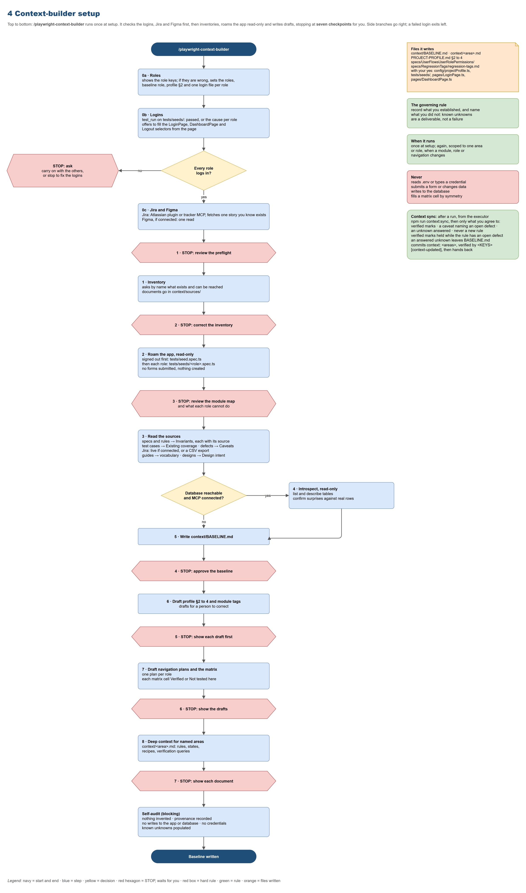
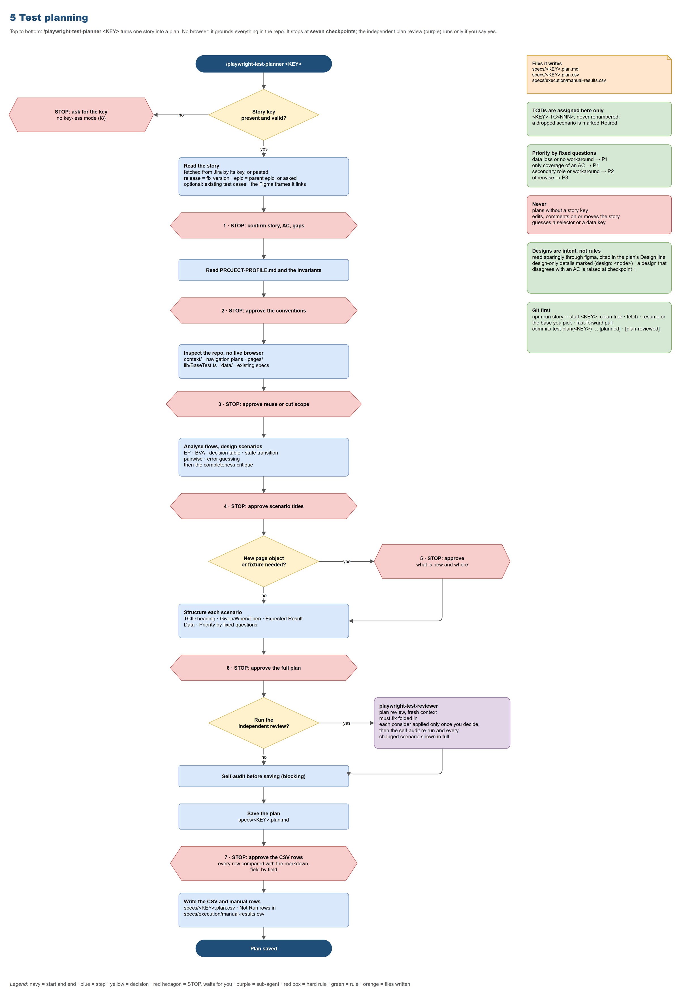
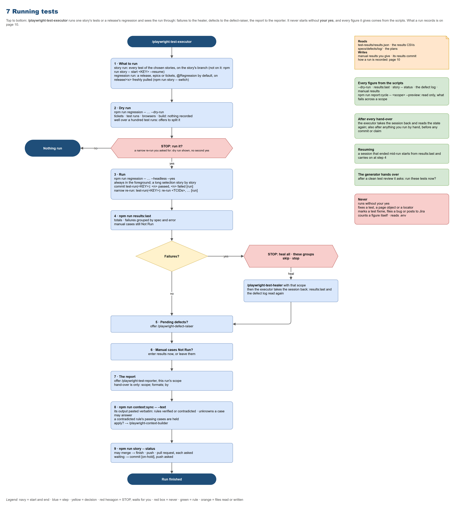
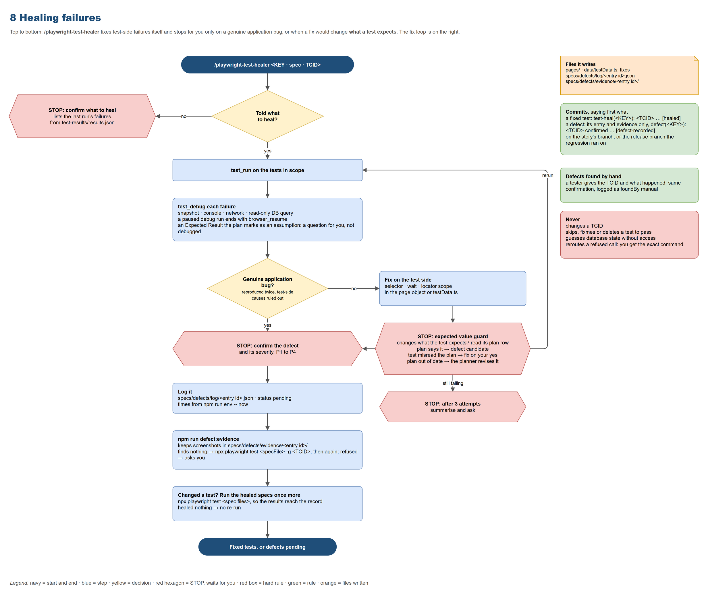
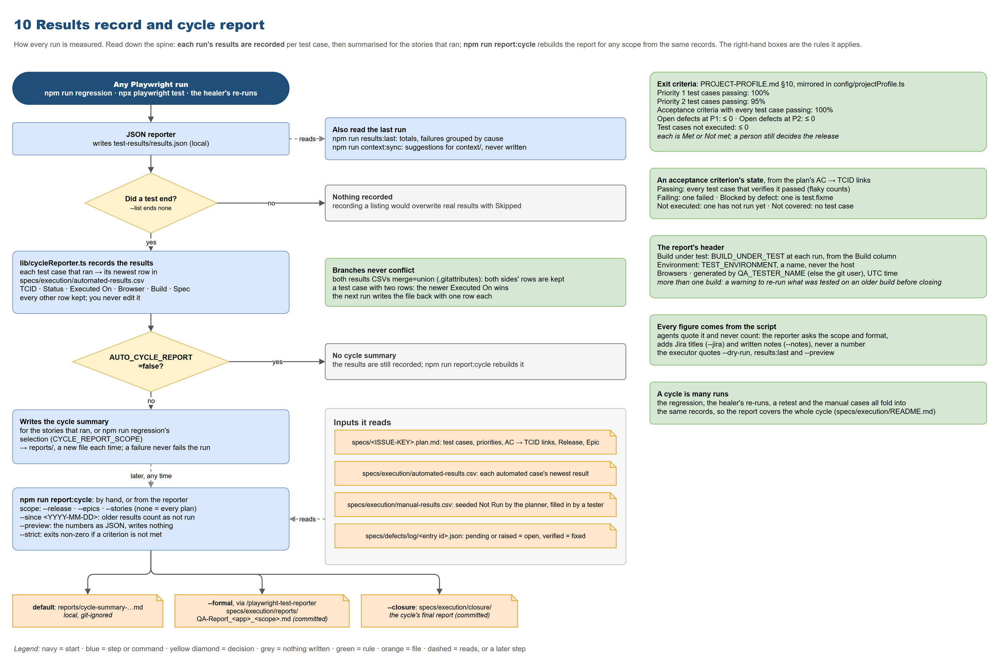
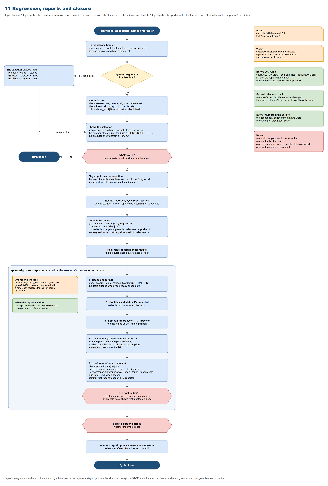
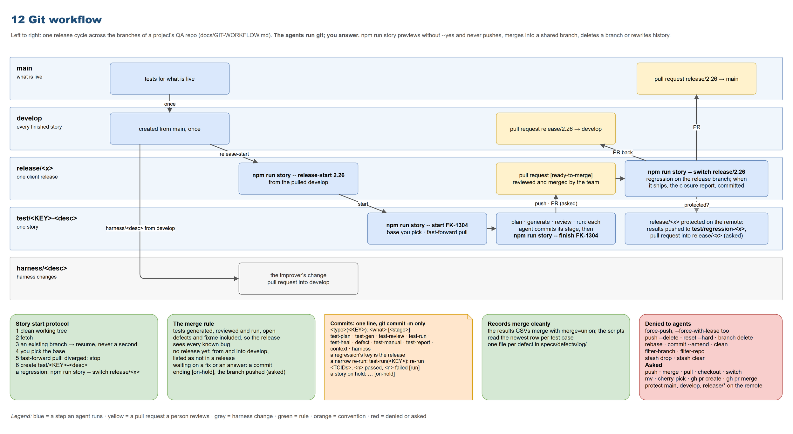
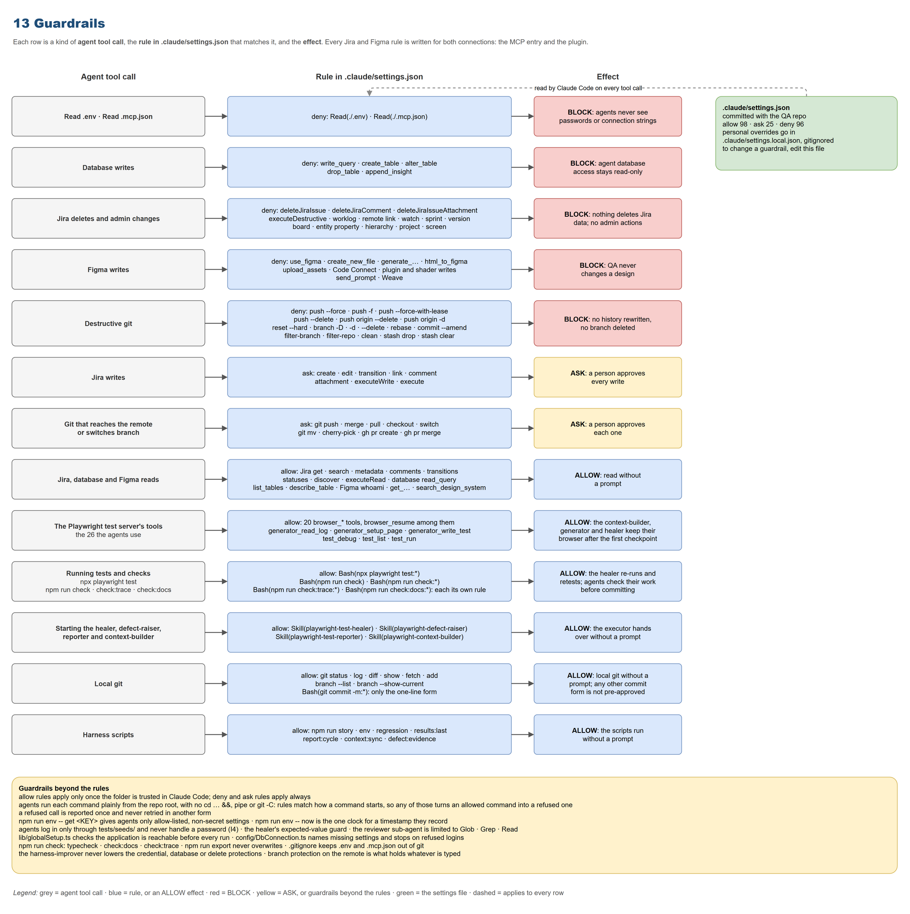
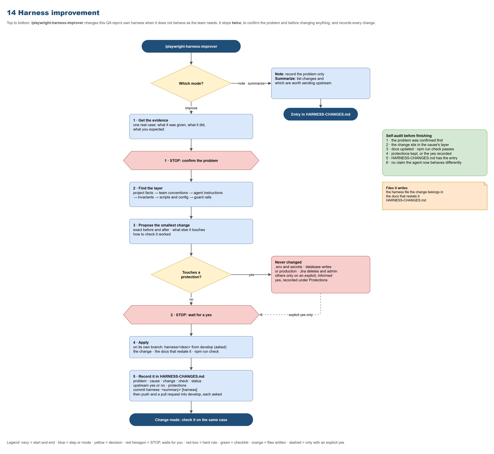

# How the AI Test Harness works

The AI Test Harness is a QA layer for Claude Code. It has nine specialist agents, shared project knowledge, a
Playwright and TypeScript test suite, and the npm scripts around it. Eight agents learn the application, plan
test cases, generate tests, review them, run them, heal failures, file defects and write the test report. A
ninth adapts the harness itself. Each agent stops for your approval at set points and works on its story's own
git branch, and permission rules in `.claude/settings.json` limit what any agent may do. Each part of the
system has a diagram below.

The guide is for QA engineers and QA leads who run the agents, and for whoever maintains a project's copy of
the harness. The agent definitions are described in [agents/README.md](../../agents/README.md), project
knowledge in [context/README.md](../../context/README.md), results, reports and closure in
[specs/execution/README.md](../../specs/execution/README.md), the defect log in
[specs/defects/README.md](../../specs/defects/README.md), and branches and commits in
[docs/GIT-WORKFLOW.md](../GIT-WORKFLOW.md). The command reference is [docs/AGENTS.md](../AGENTS.md). All the
diagrams come from one multi-page draw.io file,
[ai-qa-harness.drawio](diagrams/ai-qa-harness/ai-qa-harness.drawio) (see
[Updating the diagrams](#updating-the-diagrams)). The same guide is published as a browsable page,
[how-it-works.html](../how-it-works.html), generated from this file.

## Contents

1. [Architecture: agents, knowledge and the test suite](#1-architecture-agents-knowledge-and-the-test-suite)
2. [Agent pattern: command, definition and sub-agent](#2-agent-pattern-command-definition-and-sub-agent)
3. [End-to-end testing lifecycle](#3-end-to-end-testing-lifecycle)
4. [Set-up and the context-builder](#4-set-up-and-the-context-builder)
5. [Test planning](#5-test-planning)
6. [Test generation](#6-test-generation)
7. [Running tests](#7-running-tests)
8. [Healing failures](#8-healing-failures)
9. [Defects and retest](#9-defects-and-retest)
10. [Results record and cycle report](#10-results-record-and-cycle-report)
11. [Regression, reports and closure](#11-regression-reports-and-closure)
12. [Git workflow](#12-git-workflow)
13. [Guardrails](#13-guardrails)
14. [Harness improvement](#14-harness-improvement)
15. [Concepts that apply everywhere](#15-concepts-that-apply-everywhere)
16. [Which command do I use?](#16-which-command-do-i-use)
17. [Updating the diagrams](#updating-the-diagrams)

## 1. Architecture: agents, knowledge and the test suite


You work in a Claude Code session opened in the project's QA repo, or in a terminal in the same repo. The
agents read the knowledge layer and write the test suite. Test runs and scripts leave records.

| Layer | Folder | Holds | Executes? |
|---|---|---|---|
| Agent | `.claude/`, `agents/` | Slash commands, agent definitions, the sub-agent, permission rules | Yes. Claude Code runs the agents |
| Knowledge | `PROJECT-PROFILE.md`, `TEST-AUTHORING-INVARIANTS.md`, `context/`, `specs/` | What the agents know about the application and the rules tests follow | No |
| Test suite | `tests/`, `pages/`, `lib/`, `data/`, `config/`, `playwright.config.ts` | The Playwright suite | Yes. Playwright runs it |
| Scripts | `scripts/` | Export, prep, regression, reports, git, checks | Yes, through `npm run …` |
| Records | `specs/execution/`, `specs/defects/`, `HARNESS-CHANGES.md` | Results, reports, defects, closure reports, harness changes | No |

The agent layer:

| Path | Purpose |
|---|---|
| [.claude/commands/](../../.claude/commands/) | Nine slash-command wrappers, each pointing at its definition |
| [agents/](../../agents/) | The nine canonical agent definitions |
| [.claude/agents/](../../.claude/agents/) | The `playwright-test-reviewer` sub-agent |
| [.claude/settings.json](../../.claude/settings.json) | Permission rules: 98 allow, 25 ask and 96 deny |
| [.mcp.json.example](../../.mcp.json.example) | MCP servers: `playwright-test`, `database`, `tracker` (Jira), `figma`; copied to `.mcp.json`, which is gitignored |

The knowledge layer:

| Path | Purpose |
|---|---|
| [PROJECT-PROFILE.md](../../PROJECT-PROFILE.md) | Roles, vocabulary, modules, severity rubric, test strategy, exit criteria |
| [TEST-AUTHORING-INVARIANTS.md](../../TEST-AUTHORING-INVARIANTS.md) | Rules I1 to I8 that every test follows |
| [context/](../../context/) | `BASELINE.md`, one document per area, and `sources/` for the project's documents |
| [specs/](../../specs/) | Plans, plan templates, navigation flows per role, regression tags |

The test suite:

| Path | Purpose |
|---|---|
| [tests/](../../tests/) | `seeds/` (one login file per role), `seed.spec.ts` (signed out), `stories/`, `example.spec.ts` |
| [pages/](../../pages/) | Page objects, including `LoginPage.ts`, `DashboardPage.ts` and `common/Logout.ts` |
| [lib/](../../lib/) | `BaseTest.ts` fixtures, `globalSetup.ts` readiness check, `cycleReporter.ts`, `api/` |
| [data/](../../data/) | `testData.ts`, `auth_data.ts`, `sql_queries.ts`, `seed.ts` |
| [config/](../../config/) | `projectProfile.ts`, `testConfig.ts`, `DbConnection.ts` and its adapters |

The scripts and records:

| Path | Purpose |
|---|---|
| [scripts/](../../scripts/) | `regression.ts`, `last-run.ts`, `cycle-report.ts`, `defect-evidence.ts`, `context-sync.ts`, `story.ts`, `env.js`, `open-docs.js`, `check-docs.js`, `check-trace.ts`, and the shared code in `scripts/lib/`; in the template only, `export-harness.js` and `prep-folder.js` |
| [specs/execution/](../../specs/execution/) | `automated-results.csv`, `manual-results.csv`, `reports/` (formal reports), `closure/` |
| [specs/defects/](../../specs/defects/) | `log/` (one file per defect), `evidence/`, `defects.csv` |
| [HARNESS-CHANGES.md](../../HARNESS-CHANGES.md) | Changes a QA repo makes to its own harness |

The `playwright-test` MCP server is required by the context-builder, generator and healer. The `database`
server, with a read-only QA account, is optional. Without it, agents ask you for queries and the healer
reports database-backed failures instead of judging them. Jira is optional, through the Atlassian plugin or
the `tracker` MCP entry. Without it, you paste stories into the planner, the defect-raiser writes
`specs/defects/defects.csv` for import, and you tell the healer which defects were fixed. Figma is optional and
read-only, through the `figma` entry or the Figma plugin. Without it, you paste designs as screenshots. See
[docs/MCP.md](../MCP.md).

## 2. Agent pattern: command, definition and sub-agent


An agent is reached in one of three ways:

1. A slash command, `.claude/commands/<name>.md`, holds Claude Code frontmatter (`description`,
   `allowed-tools`, `model`, and `effort` for two agents) and one instruction: read `agents/<name>.md` and
   follow it. Its `allowed-tools` cover only the turn the command starts. The approvals that last through a
   session are the allow rules in `.claude/settings.json`.
2. The canonical definition, `agents/<name>.md`, holds all of the agent's instructions in plain Markdown.
3. The sub-agent `.claude/agents/playwright-test-reviewer.md` lets the planner and the generator start the
   reviewer in a fresh context. It also points at `agents/playwright-test-reviewer.md`.

Wrappers defer to the definition. To change how the healer treats a failing assertion, you edit
`agents/playwright-test-healer.md` and leave `.claude/commands/playwright-test-healer.md` as it is.
`npm run check:docs` fails if a wrapper or sub-agent file has no matching definition, does not point at it, or
grows beyond 8 lines of content.

Settings worth knowing:

- Every command and the sub-agent use `opus`, except the reporter, which uses `sonnet` because its numbers
  come from the script. The context-builder and planner also set `effort: xhigh`.
- The reviewer sub-agent has `tools: Glob, Grep, Read`. It never edits and never asks.
- The planner offers a plan review before saving, the generator reviews every spec it writes unless you say
  no review, and you can run `/playwright-test-reviewer` directly.
- All nine agents read `PROJECT-PROFILE.md` first. Six also read `TEST-AUTHORING-INVARIANTS.md`; the
  defect-raiser, executor and reporter do not.
- Hand-overs go through files. The generator offers the executor, and the executor hands over to the healer,
  defect-raiser, reporter and context-builder. Each hands back when it finishes, and each reads its input from
  disk, so a session that ends part-way resumes with the same command.
- Every agent runs each command plainly from the repo root, with no `cd … &&` in front, no pipe after and no
  `git -C`, because the permission rules match a command by how it starts. It commits in the one-line
  `git commit -m` form only. A refused call is reported once and never retried in another form.

## 3. End-to-end testing lifecycle


The lifecycle runs once per ticket, starting from the Jira story. Setting up a project's QA repo happens
once, before any ticket, and is in [section 4](#4-set-up-and-the-context-builder).

```text
Jira story (key + fix version)        → read through the Jira MCP server when it is connected
/playwright-test-planner <ISSUE-KEY>  → test/<ISSUE-KEY>-<desc> branch · specs/<ISSUE-KEY>.plan.md · .plan.csv · manual-results.csv rows
/playwright-test-generator <plan>     → tests/stories/<release>/<ISSUE-KEY>.spec.ts · pages/ · lib/BaseTest.ts · **Tests reviewed:** in the plan
/playwright-test-executor <ISSUE-KEY> → specs/execution/automated-results.csv
/playwright-test-healer               → fixed tests · specs/defects/log/<entry id>.json · evidence/
/playwright-defect-raiser             → a Jira bug or a specs/defects/defects.csv row · test.fixme(
  … pull request: npm run story -- finish prepares it, into release/<release>;
    a person reviews and merges …
/playwright-test-executor (regression) → automated-results.csv for the release
/playwright-test-reporter             → specs/execution/reports/QA-Report_<app>_<scope>.md · .html · .pdf
```

How the stages connect:

- People make the decisions. The planner interviews you through seven checkpoints. The generator stops for new
  page objects, SQL and the file path. The executor runs nothing without your yes. The healer asks before it
  records a defect, and the defect-raiser asks once before filing. People review and merge the pull request
  and decide whether a cycle closes.
- Every story needs its Jira issue key, and test case IDs start with it. The plan's `**Release:**` comes from
  the story's fix version, names the spec's folder under `tests/stories/` and the `release/<x>` branch the
  story merges into.
- Each stage reads its input from files, so a plan approved one day generates fine the next.
- Every run is recorded. `lib/cycleReporter.ts` writes each test case's latest result as the run ends (see
  [section 10](#10-results-record-and-cycle-report)), and each agent commits its own stage.

There are other ways in. `/playwright-test-healer` retests raised defects once they are fixed.
`/playwright-test-reviewer` reviews any plan or spec. `/playwright-harness-improver` changes the harness when
it does not fit. The `npm run` utilities (`story -- status`, `results:last`, `report:cycle`, `context:sync`,
`env`, `check`, `docs`) work at any time.

## 4. Set-up and the context-builder



A project's QA repo is set up once. From the template, `npm run prep -- <dir> --name "<project>"` makes the
folder a QA lead fills in before set-up day, and `npm run export -- <dir>` copies the harness files into the
new repo without overwriting anything. `npm run export -- <dir> --example <name>` builds a practice repo
instead. [docs/NEW-QA-REPO.md](../NEW-QA-REPO.md) has the full set-up.

Then `/playwright-context-builder` establishes what the harness knows about the application. It runs again
only when the application changes.

| Step | What happens |
|---|---|
| 0 · Preflight | Confirms or sets up the roles, runs every login file, offers to fill the login, signed-in and sign-out selectors, fetches one Jira story and makes one Figma read to prove the connections |
| 1 · Inventory | Asks by name which sources exist and can be reached |
| 2 · Roam | Signed out first (`tests/seed.spec.ts`), then each role (`tests/seeds/<role>.spec.ts`), read-only |
| 3 · Read | Specs and rules become Invariants with sources; test cases become Existing coverage; defects become Caveats; Jira live or from a CSV export; designs become Design intent |
| 4 · Introspect | Only with a reachable database and the MCP server; read-only |
| 5 to 8 · Write | `context/BASELINE.md`, profile §2 to 4 and module tags, navigation plans and the cross-role matrix, deep context per named area |

It stops for you to review the preflight, correct the inventory, review the module map, approve the
baseline, and see each profile draft, the navigation drafts and each context document. A failed login stops
it to ask whether to carry on with the other roles. It never handles a password: it starts from each role's
login file, which logs in inside the test runner, and agents cannot read `.env`. Name an area, module or role
to re-run it for that part only.

After a run, the executor hands it the suggestions you agreed to from `npm run context:sync`. That is a context
sync: a `verified: <TCID>, <date>` mark on a rule, a caveat naming an open defect, or a known unknown answered.
A rule with an open defect takes no new `verified:` marks; its passing cases are held until the defect is
fixed. An answered unknown leaves `BASELINE.md` and points to the area's caveat. A test result never becomes,
changes or removes a rule. The context-builder commits `context: … [context-updated]` and hands back.

## 5. Test planning



`/playwright-test-planner <ISSUE-KEY>` turns one story into `specs/<ISSUE-KEY>.plan.md` and its CSV.

It runs the story start protocol before anything else: `npm run story -- start`, with the base branch you
pick, or it resumes the story's existing branch (see [section 12](#12-git-workflow)). Without a Jira issue key
it stops and asks; there is no key-less mode (I8). It uses no browser and grounds the plan in the repo:
`context/`, the navigation plans, `pages/`, `data/` and existing specs.

If Figma is connected, it reads the frames the story links, sparingly, as design intent. A design is never a
requirement. Each frame is cited in the plan's `**Design:**` line, a detail taken only from a design is marked
`(design: <node>)`, and a design that disagrees with an acceptance criterion is raised at the first checkpoint.

Its seven checkpoints are the story and its gaps, conventions, reuse and scope, scenario titles, anything new,
the full plan, and the CSV rows, which it compares with the Markdown field by field. Before saving, it offers
`playwright-test-reviewer` in plan-review mode and folds the `must fix` findings in. It applies a `consider`
finding only once you decide, then re-runs its self-audit and shows you the changed scenarios in full. A clean
review is recorded as `**Plan reviewed:**` in the plan.

The planner owns the test case IDs: `<ISSUE-KEY>-TC<NNN>`, never renumbered, with a dropped scenario marked
`Retired`. Each manual scenario gets a `Not Run` row in `specs/execution/manual-results.csv`.

## 6. Test generation


`/playwright-test-generator <plan>` turns an approved plan into a spec.

It drives first. `generator_setup_page` starts from the role's login file, every step runs live through the
browser tools, and `generator_read_log` must show an action for each step before anything is written. A test
that switches role starts a new session from that role's login file. It lists any plan line it cannot
implement as written at its first checkpoint.

It stops for a missing plan or test case ID, a new page object or method, SQL it does not have, and the
target file path: `tests/stories/<release>/<ISSUE-KEY>.spec.ts`, or with no release yet the epic's folder or
`tests/stories/`.

After writing, it starts `playwright-test-reviewer` in test-review mode, fixes every `must fix` (re-driving the
step if needed) and re-reviews once. A clean review is recorded as `**Tests reviewed:**` in the plan, and a
story merges only once it is set. It commits `test-gen(<KEY>): … [tests-generated]` and
`test-review(<KEY>): … [tests-reviewed]`.

Tags follow priority. P1 and P2 get `@Regression` and `@Priority1` or `@Priority2`, P3 gets `@Priority3`, and
each test also gets a module tag from `specs/RegressionTags/regression-tags.md`. It ends by asking "run these
tests now?", and a yes hands over to the executor.

## 7. Running tests



`/playwright-test-executor` runs the tests and sees the run through. A story run covers every test of the
chosen stories. A regression run covers a release, or chosen epics or tickets, with `@Regression` tests by
default. It works on the story's branch, or switches to the release branch with `npm run story -- switch`.

It shows the selection from `npm run regression -- … --dry-run`: the tickets, test count, browsers and build,
without recording anything. It runs only on your yes, as `npm run regression -- … --headless --yes`, always in
the foreground with the longest command timeout, because a run in the background ends with a non-interactive
session. A selection that could outlast that timeout runs story by story, and a selection well over a hundred
test runs is offered as a split. For a narrow re-run you asked for by name, it shows the dry run and does not ask again. The results are committed with the counts from `npm run results:last`, as
`test-run(<KEY>): <n> passed, <n> failed [run]`, or for a narrow re-run
`test-run(<KEY>): re-run <TCIDs>, <n> passed, <n> failed [run]`.

`npm run results:last` groups failures by spec and error. You choose heal all, these groups, skip or stop, and
it hands over to the healer with that scope. Then it offers, in turn, the defect-raiser for pending defects,
the manual cases still Not Run, the reporter (handed only `scope; formats; by`), and `npm run context:sync`,
whose output it pastes verbatim for the context-builder. For a story, `npm run story -- status` decides the
end: a story that may merge is offered `finish`, push and a pull request, each asked; a story that is waiting
gets an `[on-hold]` commit.

After every hand-over it takes the session back and reads the state again, and also after anything you run by
hand. Every figure it gives comes from the dry run, `results:last`, `npm run report:cycle -- <scope> --preview`,
the defect log or the manual results; it never counts for itself. It never runs without your yes, fixes a
test, marks one `fixme`, files a bug, posts to Jira or reads `.env`.

## 8. Healing failures



`/playwright-test-healer` fixes failing tests and confirms genuine defects with you.

Name what to heal: an issue key, a spec, a test case ID, or "what failed in the last run". If you name nothing,
it lists the last run's failures from `test-results/results.json` and asks. The executor passes the groups you
chose. When the plan marks a failing case's Expected Result as the team's assumption, the healer asks you
about it and does not debug it. When it is done with a paused debug run, it ends it with `browser_resume`.

It fixes test-side problems on its own: selectors, waits and locator scope, in the page object or
`testData.ts`, up to three attempts per test. It stops for what to heal, after three attempts, and to confirm a
defect and its severity. A fix that changes what a test expects goes through the expected-value guard. If the
plan's Expected Result says what the test was checking, the application changed and it is a defect candidate.
If the test misread the plan, it fixes the test on your yes. If the plan itself is out of date, it says so and
the planner revises the plan first.

After you confirm a defect, it writes the entry as its own file, `specs/defects/log/<entry id>.json`, as
`pending`, and runs `npm run defect:evidence`, which copies the screenshots into `specs/defects/evidence/`. If
no failed result is left to copy, it re-runs that one test with `npx playwright test <specFile> -g <TCID>`
first. Every time it records comes from `npm run env -- now`.

It re-runs the healed specs once more only if it changed a test. It commits `test-heal(<KEY>): … [healed]`, and
a defect as its entry and evidence only, as `defect(<KEY>): … [defect-recorded]`. A refused call is never
rerouted through another runner or command: it tells you the exact command to run.

## 9. Defects and retest


`/playwright-defect-raiser` files the defects the healer logged. It shows the batch (summary, severity, test
case ID, story, evidence and the files it will commit) and files only what you agree to.

With Jira connected, it searches for an open bug labelled with the test case ID, then creates the bug, links it
to the story and attaches the evidence if the tools can upload. Without Jira, it appends rows to
`specs/defects/defects.csv` for import, asking once for the Reporter name, which a Jira import needs. An
automated test becomes `test.fixme(` with a defect comment, and a manual case gets the key in
`manual-results.csv`. The entry moves to `raised` with a `raisedAt` time from `npm run env -- now`, committed as
`defect(<KEY>): <n> raised … [defect-raised]`.

The retest is the healer again. It finds raised entries that Jira shows as done, or the ones you name, turns
`test.fixme(` back into `test(` and runs it twice. Passed both times, the entry becomes `verified` with a
`verifiedAt` time; otherwise the `fixme` is restored and the entry records `lastRetestAt` and
`lastRetestResult`. It commits the spec, the entry and `automated-results.csv` on the branch the spec lives on,
which is the release branch once the story is merged, as `defect(<KEY>): <TCID> fixed, verified
[defect-verified]`. A manual case is re-executed by the tester. Before writing to Jira it stops, and you choose
a comment and a transition from the bug's own workflow, or neither.

## 10. Results record and cycle report



Every Playwright run is measured the same way, whether it comes from `npm run regression`, the healer or
`npx playwright test` in a terminal. The JSON reporter writes `test-results/results.json`, then
`lib/cycleReporter.ts` records each test case's latest result in `specs/execution/automated-results.csv`, with
its status, time, browsers, build and spec. A run in which no test ended, such as `npx playwright test --list`,
records nothing.

The record is committed. It merges with `merge=union`, and the scripts read the newest row per test case, so
two story branches never conflict over it. Manual results live in `specs/execution/manual-results.csv`.

After recording, the cycle reporter writes a cycle summary for the stories that ran, to `reports/` (local, not
committed). `AUTO_CYCLE_REPORT=false` in `.env` turns that off. `npm run report:cycle` builds the same report
by hand, for `--release`, `--stories` or `--epics`, and `--since <date>` takes the latest result of every case
since the cycle began. `--preview` prints the figures as JSON and writes nothing.

The report reads the plans, both results records and the defect log, and measures them against the exit
criteria in `PROJECT-PROFILE.md` §10 (mirrored in `config/projectProfile.ts`). By default those are Priority 1
cases 100% passing, Priority 2 cases 95%, acceptance criteria with every test case passing 100%, no open P1 or
P2 defects, and no test case left not executed. An acceptance criterion passes only when every test case that
verifies it passes; one failing or defect-blocked case fails it. The header names the build from
`BUILD_UNDER_TEST` and the environment from `TEST_ENVIRONMENT`, never the host in `BASE_URL`, and warns when
the results come from more than one build.

Every figure in a report, an executor's message or a commit comes from these scripts. Agents quote them and
never count.

## 11. Regression, reports and closure



A release's regression runs on your machine, through `/playwright-test-executor` (say *regression for 2.26*) or
`npm run regression` in a terminal. The formal report is `/playwright-test-reporter`'s.

Before you run it, set `BUILD_UNDER_TEST` and `TEST_ENVIRONMENT` in `.env`, and retest defects reported fixed.
The regression runs on `release/<release>`; the executor switches to it with `npm run story -- switch`.

In a terminal, `npm run regression` asks which release (a number, several, `all`, or no release yet), which
tickets (all, by epic, or chosen), and whether to run only `@Regression` tests. The executor passes the answers
as flags: `--release`, `--epics`, `--stories`, `--all-tests`, `--browser`, `--grep`, `--headless`, `--dry-run`,
`--yes`. It runs every browser project in `playwright.config.ts` unless you pass `--browser`, and nothing runs
before your yes. The results commit is `test-run(<release>): regression, …`; if the remote protects release
branches, it goes to `test/regression-<x>` and a pull request into `release/<x>`.

The reporter asks the scope (a story, several, an epic or a release) and the format (Markdown, HTML or PDF),
unless you already chose both. It adds Jira titles and status when connected, previews the figures with
`--preview`, and writes two to five sentences of notes from them and the plan rows. A failing case the plan
marks as the team's assumption is reported as an open question for the BA. It writes
`specs/execution/reports/QA-Report_<app>_<scope>` with `npm run report:cycle -- --formal`, commits it as
`test-report(<scope>): … [reported]`, and offers a test-summary comment on each Jira story, asked first. There is
one report per scope: a new one replaces the last, and git keeps the history.

At the end, a person decides whether the cycle closes. `npm run report:cycle -- --closure` writes the final
report to `specs/execution/closure/`.

## 12. Git workflow



Every story's work happens on its own branch. The agents run git and you answer. The full workflow is in
[docs/GIT-WORKFLOW.md](../GIT-WORKFLOW.md).

| Branch | Holds | Created from | Merges into |
|---|---|---|---|
| `main` | The tests for what is live | (none) | (none) |
| `develop` | Every finished story's tests | `main`, once | (none) |
| `release/<x>` | One client release's stories; its regression runs here | the latest `develop` | `main`, and back into `develop`, when the release closes |
| `test/<KEY>-<desc>` | One story | the freshly pulled `release/<x>`; `develop` with no release yet | its base, by pull request |
| `harness/<desc>` | A harness change, the improver's | `develop` | `develop` |

`npm run story` has five commands. `status` works out each story's stage and whether it may merge from the
files, every time. `start` runs the story start protocol: a clean tree, a fetch, resuming an existing branch,
the base you pick and a fast-forward pull. `switch` moves to a branch, `release-start` creates `release/<x>` from the freshly pulled `develop`, and
`finish` checks the merge rule and brings the latest base into the story's branch. Without
`--yes` each only shows what it would do, and none pushes, merges into a shared branch, deletes a branch or
rewrites history.

A story merges once its tests are generated, reviewed and run. Open defects and `test.fixme` are included, so
the release sees every known bug. A story that is waiting gets an `[on-hold]` commit instead.

Commits are one line, written as `git commit -m "<type>(<KEY>): <what> [<stage>]"`, with no body and no
trailer. The types are `test-plan`, `test-gen`, `test-review`, `test-run`, `test-heal`, `defect`, `test-manual`,
`test-report`, `context` and `harness`. The results CSVs merge with `merge=union` and each defect is its own
file, so records merge cleanly. Protect `main`, `develop` and `release/*` on the remote: the permission rules
stop the usual destructive commands, and branch protection holds whatever is typed.

## 13. Guardrails



The harness has no hook scripts. Its guardrails are permission rules in
[.claude/settings.json](../../.claude/settings.json), which Claude Code applies to every agent tool call: 98
`allow`, 25 `ask` and 96 `deny` rules. Every Jira and Figma rule is written for both connections: Jira's
`mcp__tracker__` and `mcp__plugin_atlassian_atlassian__`, and Figma's `mcp__figma__` and
`mcp__plugin_figma_figma__`.

| Rule | Behaviour |
|---|---|
| `Read(./.env)`, `Read(./.mcp.json)` | **Blocks**: agents never see passwords or connection strings |
| Database write tools | **Blocks** `write_query`, `create_table`, `alter_table`, `drop_table`, `append_insight` |
| Jira deletes | **Blocks** issue, comment and attachment deletes, and `executeDestructive` |
| Jira admin and project tools | **Blocks** worklog, remote link, watch, sprint, version, board, entity property, hierarchy, project and screen changes |
| Destructive git | **Blocks** force-push, push `--delete`, `reset --hard`, branch delete, `rebase`, `commit --amend`, `filter-branch`, `filter-repo`, `clean`, `stash drop` and `stash clear` |
| Figma writes | **Blocks** every tool that writes to Figma: `use_figma`, `create_new_file`, the `generate_…` tools, uploads, Code Connect, plugin and shader writes, `send_prompt`, Weave runs |
| Jira writes | **Asks** before create, edit, transition, link, comment, attachment, `executeWrite`, `execute` |
| Git that reaches the remote or switches branch | **Asks** before `push`, `merge`, `pull`, `checkout`, `switch`, `mv`, `cherry-pick`, `gh pr create`, `gh pr merge` |
| Jira, database and Figma reads | Allowed without a prompt |
| The Playwright test server's tools the agents use | Allowed, so the context-builder, generator and healer keep their browser after the first checkpoint. These are the same tools their commands already grant, and `browser_resume`, which ends a paused debug run |
| Running one test: `npx playwright test` | Allowed, so the healer can re-run a test for its evidence and run a retest after the executor hands over |
| Starting the healer, defect-raiser, reporter and context-builder | Allowed, so the executor can hand a run over to each without a prompt |
| Local git and the harness scripts | Allowed: `git status`, `log`, `diff`, `show`, `fetch`, `add` and `commit -m`; `npm run story`, `env`, `check` (and `check:trace`, `check:docs`, each its own rule), `regression`, `results:last`, `report:cycle`, `context:sync`, `defect:evidence` |

The `allow` rules apply only after you accept Claude Code's trust dialog for the folder; `deny` and `ask` rules
apply always. To change a guardrail, edit `.claude/settings.json`. Personal overrides go in
`.claude/settings.local.json`, which is gitignored. Rules match a Bash command by how it starts, so agents run
each command plainly from the repo root, and `git push origin x --force` would not match `git push --force:*`.
Branch protection on the remote is the real guard for git.

Safeguards beyond the rules:

- Agents log in only through `tests/seeds/` and never handle a password (I4).
- `npm run env -- get <KEY>` gives agents only allow-listed, non-secret settings; passwords, emails, tokens and
  database settings are always refused. `npm run env -- now` is the one clock agents use for a time they
  record.
- A refused call is reported once and never retried in another form.
- The healer's expected-value guard, and the reviewer sub-agent limited to `Glob`, `Grep` and `Read`.
- `lib/globalSetup.ts` checks the application is reachable before every run.
- `config/DbConnection.ts` names missing settings before connecting and stops on refused logins.
- `npm run check` runs the typecheck, `check:docs` (including every setting the code reads being in
  `.env.example`) and `check:trace`.
- `npm run export` never overwrites, and `.gitignore` keeps `.env` and `.mcp.json` out of git.
- The harness-improver never lowers the credential, database or delete protections.

## 14. Harness improvement



`/playwright-harness-improver` changes a QA repo's own harness when it does not behave as the team needs. It
works on a `harness/<desc>` branch from `develop`.

1. It gets the evidence: one real case, with what the agent was given, what it did and what you expected.
2. **STOP**: you confirm the problem statement.
3. It finds the layer, most specific first: project facts, team conventions, agent instructions, invariants,
   scripts and config, guard rails. A wrong fact is fixed as a fact.
4. It proposes the smallest change, with the exact before and after, what else it touches and how to check it.
5. It checks the protections. Credential, database and Jira-delete protections never change; the others change
   only on an explicit yes, recorded.
6. **STOP**: it waits for your yes.
7. It applies the change, updates the docs that restate it, and runs `npm run check`.
8. It records an entry in [HARNESS-CHANGES.md](../../HARNESS-CHANGES.md): problem, cause, change, check, status,
   upstream and protections. It commits `harness: … [harness]` and offers to push and open a pull request into
   `develop`, each asked.

Its self-audit has 6 items, from "the problem was confirmed first" to "no claim the agent now behaves
differently". It has two other modes: **Note** records a problem without changing anything, and **Summarize**
lists the repo's changes and which are worth sending to the template.

## 15. Concepts that apply everywhere

- Every story needs its Jira issue key. Each test case is `<ISSUE-KEY>-TC<NNN>`, starts its test's title, and
  links the acceptance criterion to the result, the defect and the Jira bug. `npm run check:trace` enforces it
  (I8).
- [TEST-AUTHORING-INVARIANTS.md](../../TEST-AUTHORING-INVARIANTS.md) holds I1 to I8: page objects, fixtures,
  test data, credentials, assertion values, environment config, locator uniqueness and traceability.
- Each role key appears in `config/projectProfile.ts`, profile §2, `.env` as `<ROLE>_EMAIL` and
  `<ROLE>_PASSWORD`, and one login file in `tests/seeds/`.
- A plan's `**Release:**` is the client's release, from the Jira fix version, and names its `release/<x>`
  branch. The harness's own version lives only in the template's `CHANGELOG.md`; each QA repo records the
  version it was copied from in profile §1.
- Story status is worked out each time. `npm run story -- status` reads the plan, its review lines, the
  spec, the results and the defect log every time.
- Numbers come from scripts. The executor and the reporter quote what `results:last` and `report:cycle` print,
  and no agent counts. Times come from `npm run env -- now`.
- Records are committed. Results, manual results, the defect log, evidence, formal reports and closure reports
  live in the QA repo, so the whole team works from one record.
- A Figma frame guides a plan's wording and states as design intent. The acceptance criteria and `context/`
  decide.
- Every agent runs on `opus`, except the reporter on `sonnet`; the context-builder and planner use
  `effort: xhigh`.
- The template names no application. A project's copy holds its own names in the profile, `context/` and
  `data/`.

## 16. Which command do I use?

| I want to… | Run |
|---|---|
| Prepare the folder for a new QA repo (from the template) | `npm run prep -- <dir> --name "<project>"` |
| Copy the harness into a QA repo (from the template) | `npm run export -- <dir>` |
| Build a practice repo (from the template) | `npm run export -- <dir> --example <name>` |
| Teach the harness the application | `/playwright-context-builder` |
| See where each story is, and whether it may merge | `npm run story -- status` |
| Start or resume work on a story | `npm run story -- start <ISSUE-KEY>` (the planner runs it for you) |
| Switch to a release branch, start one, or finish a story | `npm run story -- switch`, `release-start`, `finish` |
| Plan test cases for a story | `/playwright-test-planner <ISSUE-KEY>` |
| Generate tests from a plan | `/playwright-test-generator <plan>` |
| Review a plan or spec independently | `/playwright-test-reviewer` |
| Run a story's tests, or a release's regression | `/playwright-test-executor` |
| Fix failing tests | `/playwright-test-healer <ISSUE-KEY>` |
| File confirmed defects | `/playwright-defect-raiser` |
| Retest fixed defects | `/playwright-test-healer`, asking it to retest raised defects |
| Write the test report | `/playwright-test-reporter` |
| Change how the harness behaves | `/playwright-harness-improver` |
| Run a release's regression in a terminal | `npm run regression` |
| See the last run's failures, grouped | `npm run results:last` |
| See what a run confirmed in `context/` | `npm run context:sync` |
| Read a non-secret setting, list them, or get the current time | `npm run env -- get <KEY>` · `npm run env -- list` · `npm run env -- now` |
| Run every `@Regression` test | `npm run test:regression` |
| Run the whole suite | `npm test` |
| Watch or step through tests | `npm run test:ui` · `npm run test:headed` · `npm run test:debug` |
| Run the API project | `npm run test:api` |
| Rebuild, preview or close the cycle report | `npm run report:cycle` (`--release`, `--stories`, `--epics`, `--since`, `--list`, `--preview`, `--closure`, `--formal`, `--format`) |
| Keep a defect's screenshots | `npm run defect:evidence` |
| Open the last HTML report | `npm run report` |
| Check the database connection | `npm run db:check` |
| Check types, docs and traceability | `npm run check` |
| Open the handbook | `npm run docs` |
| Install the browsers | `npm run setup` |

## Updating the diagrams

Edit [ai-qa-harness.drawio](diagrams/ai-qa-harness/ai-qa-harness.drawio) in draw.io desktop, or in VS Code with
the "Draw.io Integration" extension. Then export one PNG per page from `docs/harness-docs/diagrams/ai-qa-harness`:

```bash
DRAWIO="/c/Program Files/draw.io/draw.io.exe"   # a per-user install: "$LOCALAPPDATA/Programs/draw.io/draw.io.exe" · macOS: /Applications/draw.io.app/Contents/MacOS/draw.io · Linux: drawio
names=(01-architecture 02-agent-pattern 03-testing-lifecycle 04-context-builder-setup 05-test-planning
       06-test-generation 07-running-tests 08-healing-failures 09-defects-and-retest
       10-results-record-and-cycle-report 11-regression-reports-and-closure 12-git-workflow 13-guardrails
       14-harness-improvement)
for i in "${!names[@]}"; do
  "$DRAWIO" -x -f png -p $((i + 1)) -s 1.5 -b 20 -o "${names[$i]}.png" ai-qa-harness.drawio
done
```

The browsable page [docs/how-it-works.html](../how-it-works.html) is generated from this file. Edit the
Markdown, never the HTML, then run `python docs/harness-docs/build-html.py`; `--check` reports a stale page.

Update the diagrams, this guide and its HTML page whenever a harness change adds, renames or removes a
command, agent, guardrail rule or workflow step.
